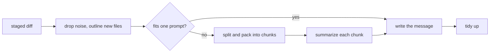

# nib

**Commit messages written on your Mac by Apple Intelligence.**
Your code never leaves the machine. No API key, no account, no cost, works offline.

```console
$ git add -A
$ nib
feat(planner): split large diffs into prompt-sized chunks

- Pack files into chunks most-changed first so small edits share space
- Truncate oversized hunks in the middle, keeping their start and end
- Retry with smaller chunks when the context window overflows
```

<!-- TODO: demo GIF of `git commit` with the hook installed -->

## Why

AI commit tools usually send your diff to someone else's server and bill you per token.
macOS 26 ships a capable language model on every Apple Intelligence Mac, and the
[Foundation Models framework](https://developer.apple.com/documentation/foundationmodels)
lets any app use it. nib is a small, native Swift tool that does exactly one thing with it.

- **Private.** The diff goes to the on-device model and nowhere else.
- **Free.** There are no tokens to pay for.
- **Fits your repo.** Follows Conventional Commits if your history does, plain sentences if it doesn't.
- **Out of the way.** The git hook never blocks a commit. If anything goes wrong, you get your usual empty editor.

## Install

Requires macOS 26 or later on Apple silicon, with Apple Intelligence turned on, and Xcode 26 or later.

```sh
git clone https://github.com/seckinbeduk/nib.git
cd nib
./install.sh
```

`install.sh` builds a release binary and copies it to `/opt/homebrew/bin` if that's writable, otherwise to `~/.local/bin`.
Run `nib doctor` to check everything is in place.

## Use

```sh
nib                  # print a message for the staged changes
nib commit           # write it, confirm in the terminal (Enter / e / r / n), commit
nib commit -y        # commit without asking
nib hook install     # from now on, `git commit` opens with the message already written
nib generate --plan  # show how a big diff would be split, without calling the model
```

Prefer to stay in the terminal? `nib commit` shows the message and asks before committing:
Enter commits, `e` opens your git editor, `r` writes a new one, `n` cancels. A git alias makes it
feel built in: `git config --global alias.ai '!nib commit'`, then `git ai`.

Prefer your editor? With the hook installed, `git commit` works as always, the message is just already there.
`git commit -m "…"`, merges, amends and templates are left alone.

## How it handles big diffs

The on-device model has a context window of a few thousand tokens (8K on macOS 27), shared between the instructions,
the diff and the answer. A real-world diff is often far bigger. nib deals with that in six steps:



1. **Drop the noise.** Lockfiles, build output, vendored code, minified files, Xcode project files,
   snapshots and binaries are listed by name and size, but their content is never sent. Neither is
   the content of deleted files.
2. **Outline new files.** A new file is sent as its skeleton: types, functions, the first line of
   each doc comment, Markdown headings. That says what the file is for at a fraction of the cost,
   and on-device the cost is time: the model reads roughly a few hundred tokens per second.
   Edited files are always sent as real hunks, because that's where the change is.
3. **Measure, don't guess.** nib asks the model's own tokenizer how many tokens a sample of the diff
   takes (macOS 26.4+), so the budget is right for this particular diff, whether it's dense Swift or
   wordy Markdown.
4. **Split and pack.** If the diff doesn't fit, big files are cut at hunk boundaries, and a single
   giant hunk keeps its start and end with the middle elided. The pieces are packed into chunks with
   the most-changed files first. Small edits fill the gaps, and if the chunk limit is reached it's
   the least-changed code that gets left out.
5. **Summarize, then write.** Each chunk is summarized on its own, and the message is written from
   the summaries plus the full list of changed files. If the summaries are too long themselves,
   they're condensed again.
6. **Structure, then polish.** The message is generated with `@Generable`, so the model fills in
   typed fields instead of free text. The bullets come first and the subject after, so the
   one-line summary is written from what the model has already worked out. nib then enforces
   the rules a small model forgets: imperative subject under 72 characters, no trailing period,
   a valid type, wrapped body.

If the model still reports a context overflow, nib shrinks the chunks and tries again.
Cheap hints help too: a change that only touches docs is nudged towards `docs`, and the
directory every file shares is offered as the scope.

## Configure

Settings live in git config, per repo or with `--global`:

| Key | Values | Default |
| --- | --- | --- |
| `nib.style` | `auto`, `conventional`, `plain` | `auto` (matches your recent commits) |
| `nib.language` | `en`, `tr`, `de`, … or a language name | English |
| `nib.ticket` | `true`, `false`: add `Refs: ABC-123` when the branch name has a ticket ID | `true` |
| `nib.timeout` | seconds | `120` |
| `nib.verbose` | `true` to show progress in the hook | `false` |

```sh
git config --global nib.language tr
```

Command-line flags `--style`, `--language`, `--timeout` and `--verbose` override these for one run.

## Develop

```sh
swift build
swift test
```

`NibCore` holds everything that doesn't need the model (diff parsing, budgeting, prompts,
formatting, the hook) and is tested with a fake model. `Sources/nib` is the command-line tool
and the Apple Intelligence backend.

## License

MIT
