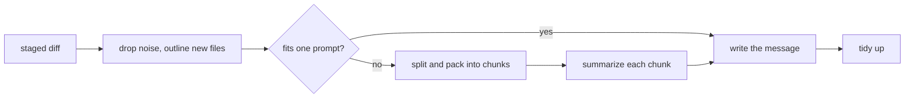

# nib

**Commit messages written on your Mac by Apple Intelligence.**
Your code never leaves the machine. No API key, no account, no cost, works offline.


## Why

AI commit tools usually send your diff to someone else's server and bill you per token.
macOS 26 and later ship a capable language model on every Apple Intelligence Mac, and the
[Foundation Models framework](https://developer.apple.com/documentation/foundationmodels)
lets any app use it. nib is a small, native Swift tool that does exactly one thing with it.

- **Private.** The diff goes to the on-device model and nowhere else.
- **Free.** There are no tokens to pay for.
- **Fits your repo.** Follows Conventional Commits if your history does, plain sentences if it doesn't.
- **Out of the way.** The git hook never blocks a commit. If anything goes wrong, you get your usual empty editor.

## Install

Needs an Apple silicon Mac with Apple Intelligence turned on, or [Hearth](https://github.com/seckinbeduk/hearth) running.

### Homebrew

On macOS 27 or later:

```sh
brew install seckinbeduk/tap/nib
nib doctor
```

Then commit with `git nib`. Update with `brew upgrade nib`.

### Build from source

The Homebrew binary is ad-hoc signed, not notarized. Building from source gives you your own copy.
Pick the version for your macOS:

| macOS | nib | Builds with | What you get |
|---|---|---|---|
| 27 or later | [latest](https://github.com/seckinbeduk/nib/releases/latest) (0.3.0+) | Xcode 27 | Everything, and Hearth is used automatically when it's running |
| 26 | [0.2.1](https://github.com/seckinbeduk/nib/releases/tag/v0.2.1) | Xcode 26 | Everything except automatic Hearth; set `nib.engine hearth` to use it |

```sh
git clone https://github.com/seckinbeduk/nib.git
cd nib
git checkout v0.2.1   # macOS 26 only
./install.sh
```

`install.sh` builds a release binary and copies it to `/opt/homebrew/bin` if that's writable, otherwise to `~/.local/bin`,
with a `git-nib` link next to it so `git nib` works. Help is `git nib -h` (`git nib --help` opens a man page,
which only the Homebrew install has).
If you installed nib with Homebrew, run `brew uninstall nib` first; `install.sh` would replace Homebrew's link and break `brew upgrade`.
Switching to Homebrew later? Remove the `install.sh` copy first (`rm /opt/homebrew/bin/nib`), or Homebrew can't link its own.
Run `nib doctor` to check everything is in place.

## Use

```sh
git nib              # write the message, confirm in the terminal (Enter / e / r / t / n), commit
git nib -y           # commit without asking
nib                  # just print a message for the staged changes
nib hook install     # from now on, `git commit` opens with the message already written
nib generate --plan  # show how a big diff would be split, without calling the model
```

Prefer to stay in the terminal? `git nib` shows the message and asks before committing:
Enter commits, `e` opens your git editor, `r` writes a new one, `t` picks another type, `n` cancels.
The model sometimes says `feat` for a fix; `t` then `x` makes it `fix(scope): …` without calling the model again
(`f` feat, `x` fix, `r` refactor, `p` perf, `d` docs, `t` test, `b` build, `c` ci, `h` chore, `s` style).
There's no `t` for plain-style messages, which have no type.
It's the same as `nib commit`, and works from any folder in the repo.

Prefer your editor? With the hook installed, `git commit` works as always, the message is just already there.
`git commit -m "…"`, merges, amends and templates are left alone.

## How it handles big diffs

The on-device model has a context window of a few thousand tokens (8K on macOS 27), shared between the instructions,
the diff and the answer. A real-world diff is often far bigger. nib deals with that in six steps:



1. **Drop the noise.** Lockfiles, build output, vendored code, minified files, Xcode project files,
   snapshots and binaries are listed by name and size, but their content is never sent. Neither is
   the content of deleted files.
2. **Outline new files.** A new file is sent as its skeleton: types, functions, the first line of
   each doc comment, Markdown headings. That says what the file is for at a fraction of the cost,
   and on-device the cost is time: the model reads roughly a few hundred tokens per second.
   Edited files are always sent as real hunks, because that's where the change is.
3. **Measure, don't guess.** nib asks the model's own tokenizer how many tokens a sample of the diff
   takes, so the budget is right for this particular diff, whether it's dense Swift or
   wordy Markdown.
4. **Split and pack.** If the diff doesn't fit, big files are cut at hunk boundaries, and a single
   giant hunk keeps its start and end with the middle elided. The pieces are packed into chunks with
   the most-changed files first. Small edits fill the gaps, and if the chunk limit is reached it's
   the least-changed code that gets left out.
5. **Summarize, then write.** Each chunk is summarized on its own, and the message is written from
   the summaries plus the full list of changed files. If the summaries are too long themselves,
   they're condensed again.
6. **Structure, then polish.** The message is generated with `@Generable`, so the model fills in
   typed fields instead of free text. The bullets come first and the subject after, so the
   one-line summary is written from what the model has already worked out. nib then enforces
   the rules a small model forgets: imperative subject under 72 characters, no trailing period,
   a valid type, wrapped body. A subject that lists several changes or only names a file
   ("update ci workflow") is replaced by the first bullet when that says more.

If the model still reports a context overflow, nib shrinks the chunks and tries again.
Cheap hints help too: a change that only touches docs is set to `docs`, and the directory every
file shares is offered as the scope. The model's scope is then checked against the changed files:
an invented one becomes that shared module, and one that is only a manifest's name (`package` from
`Package.swift`) is replaced by the module, or dropped when there is none.

## Configure

Settings live in git config, per repo or with `--global`:

| Key | Values | Default |
| --- | --- | --- |
| `nib.style` | `auto`, `conventional`, `plain` | `auto` (matches your recent commits) |
| `nib.language` | `en`, `tr`, `de`, … or a language name | English |
| `nib.ticket` | `true`, `false`: add `Refs: ABC-123` when the branch name has a ticket ID | `true` |
| `nib.timeout` | seconds | `120` |
| `nib.verbose` | `true` to show progress in the hook | `false` |
| `nib.engine` | `auto` (Hearth when it's running, else Apple Intelligence), `apple`, `hearth` | `auto` |
| `nib.hearthModel` | `apple-intelligence` (Apple's model, counted in Hearth) or `hearth` (Hearth's local model) | `apple-intelligence` |

```sh
git config --global nib.language tr
```

Command-line flags `--style`, `--language`, `--timeout` and `--verbose` override these for one run.

## Works with Hearth

[Hearth](https://github.com/seckinbeduk/hearth) runs models on your Mac and shows which app uses
how much. When it's running, nib talks to Apple Intelligence through it, with no slowdown, so
every commit shows up in Hearth's **Who's using it**. When it isn't, nib uses Apple Intelligence
directly. Nothing to configure; nib uses [HearthKit](https://github.com/seckinbeduk/hearthkit) for this.

```sh
git config --global nib.hearthModel hearth   # use Hearth's local model (Qwen, Gemma…) instead
git config --global nib.engine apple         # never use Hearth
```

No Apple Intelligence on this Mac? Run Hearth with a local model and nib uses that.
`nib doctor` shows what nib will use.

## Develop

```sh
swift build
swift test
```

`NibCore` holds everything that doesn't need the model (diff parsing, budgeting, prompts,
formatting, the hook) and is tested with a fake model. `Sources/nib` is the command-line tool
and the Apple Intelligence backend; `NibTests` covers its error mapping without calling a model.

## License

MIT
